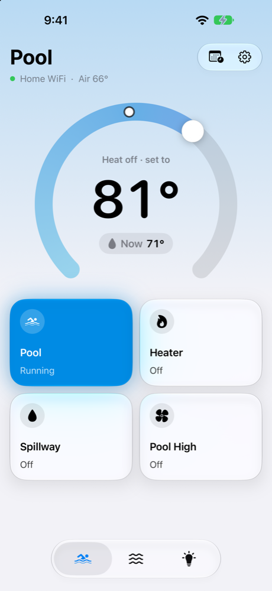
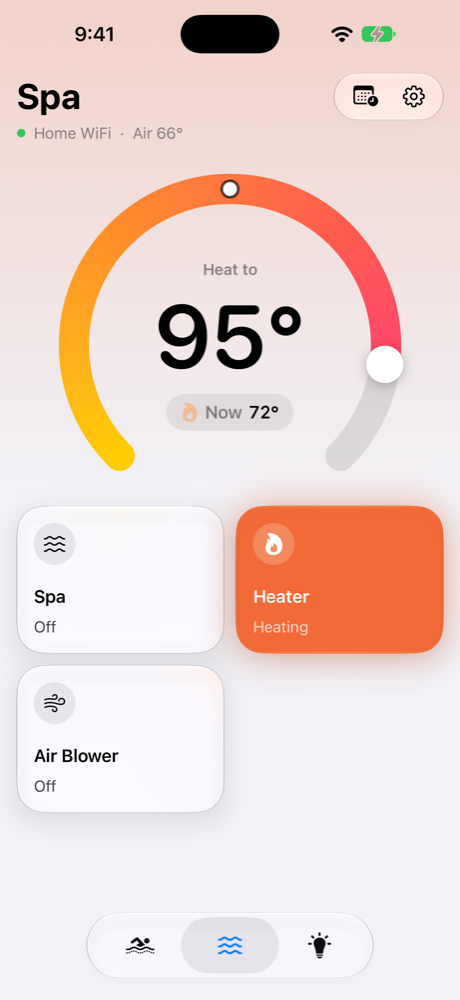
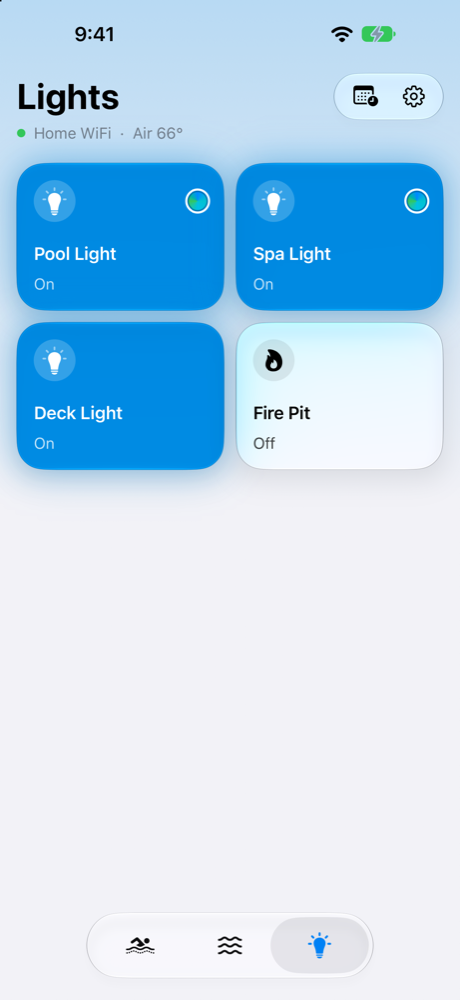
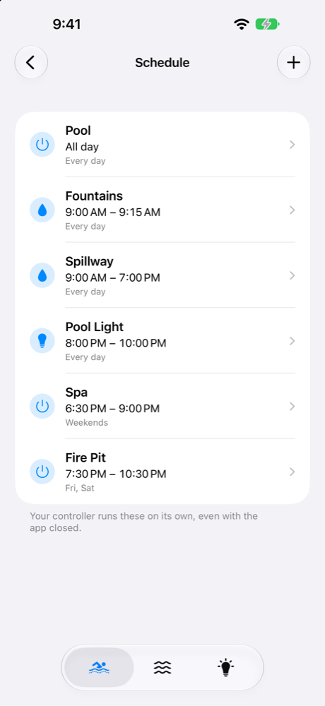
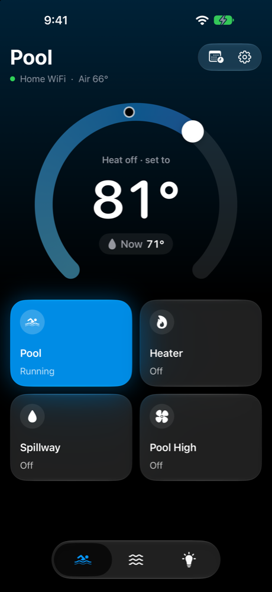
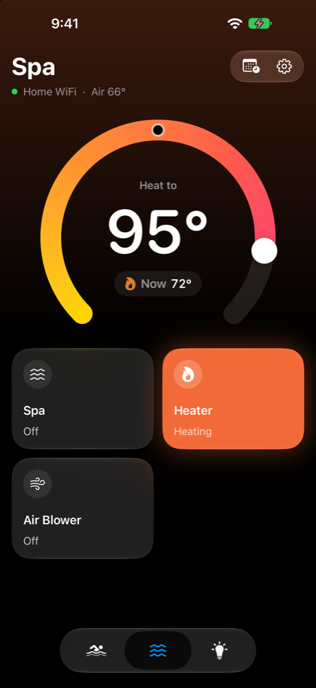
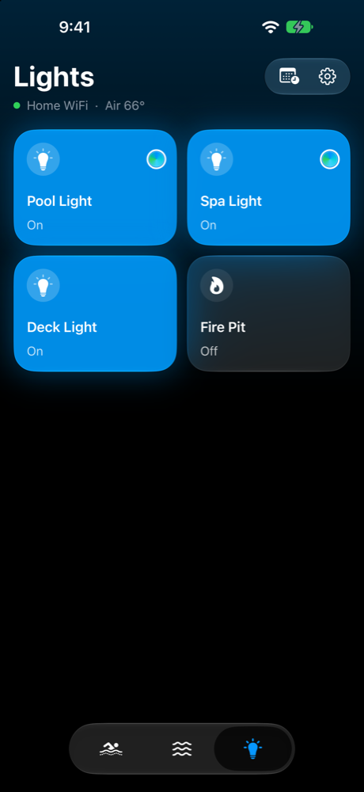
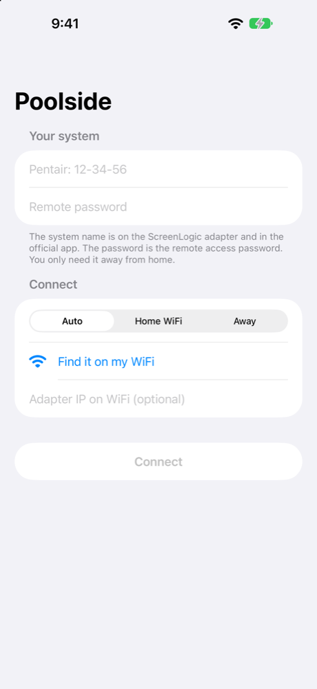

# Poolside

A personal iOS app for a Pentair ScreenLogic pool system. Works on home WiFi and away from home. See SPEC.md for what it does and why.

## Design

Screenshots from the simulator in demo mode (sample data, see below).

<p>




</p>
<p>




</p>

- **Pool and Spa** each have a dial for the heat target. Drag the knob; the big number is what you're setting and the chip under it is the water now. A small marker on the ring shows the current temperature. Below are on/off switches: pool, heater, spillway and pool high; or spa, heater and air blower.
- **Colors** stay blue. A tab turns warm only while its heater is actually firing, not just switched on.
- **Lights** is a 2x2 grid with the fire pit. Long-press a color light to pick a color or show. The controller sets every color light at once.
- **Schedule** (calendar button, top right) lists the controller's schedules. Tap to edit, + to add, swipe to delete.
- Follows the system light or dark setting. The tab bar is icons only.

 The icon is drawn by `tools/app_icon.swift` (light, dark and tinted).

## Run it on your phone

1. Open `Poolside.xcodeproj` in Xcode 16 or newer. (If it won't open, `brew install xcodegen && xcodegen` in this folder rebuilds it from `project.yml`.)
2. Select the Poolside target, then Signing & Capabilities, and pick your team. A personal Apple ID works.
3. If Xcode complains about the bundle id, change `com.stylehatch.poolside` to anything unique.
4. Plug in the iPhone, turn on Developer Mode if asked, and press Run.
5. On first launch, allow Local Network access. Without it the app can only connect remotely.
6. Sign in with the system name (`Pentair: XX-XX-XX`) and the remote access password. "Find it on my WiFi" fills the name in if the adapter answers.

A free Apple ID install expires after 7 days. A paid developer account keeps it for a year.

## Try it without touching the pool

```
python3 tools/mock_gateway.py --port 8080 --password 1234
```

Then in the app: Home WiFi, adapter IP = your Mac's IP, port 8080 in Settings. The mock answers discovery, login, status and every command, and keeps state in memory.

To check your real adapter from a Mac before debugging the app (read-only, changes nothing):

```
python3 tools/protocol_check.py --discover
python3 tools/protocol_check.py --host 192.168.1.50
python3 tools/protocol_check.py --remote "Pentair: 12-34-56" --password 1234
```

The password check needs `pip install cryptography`. Add `--schedules` to also print the schedules.

### Demo mode

Debug builds accept launch arguments (Xcode: Product > Scheme > Edit Scheme > Arguments):

- `-demo`: sample data, never connects to a pool. Used for the screenshots.
- `-tab pool|spa|lights`: start on a tab.
- `-openSchedule`: open the schedule screen.
- `-demoSignIn`: with `-demo`, show the sign-in screen.

## Layout

- `Poolside/Protocol`: ScreenLogic wire format, login, password encryption, discovery, Pentair's remote lookup.
- `Poolside/Model`: sign-in storage (Keychain for the password) and the app state.
- `Poolside/Views`: the three tabs, the temperature dial, glass switches, schedule list and editor, sign-in, settings.
- `tools`: the mock adapter, the read-only checker and the app icon script.

## What's been checked

- The mock adapter and the checker were run against node-screenlogic, the reference library: discovery, password encryption (matches its test vector), config, status and all four commands agree.
- The app builds cleanly in Xcode 26 for the iOS simulator.
- Tried read-only against a real adapter: the checker logged in on home WiFi with no password and read config and status. Over Pentair's remote server, the checker and the app's Swift protocol code both logged in and decoded the same values.
- Discovery found the real adapter on WiFi. Only the subnet broadcast got an answer; the 255.255.255.255 broadcast didn't.
- Commands from the app have reached the real controller: circuits and lights on and off, heat mode and the target temperature.
- Schedules: the app's Swift code reads the real adapter's 7 schedules correctly. Add, edit and delete pass against the mock adapter; none has been sent to the real controller yet.
- Light colors: the controller doesn't report the current color, so the app shows the last one picked in the app.

## Credits

Protocol details come from node-screenlogic (MIT) and screenlogicpy (GPL-3.0). Personal use, not affiliated with Pentair.
