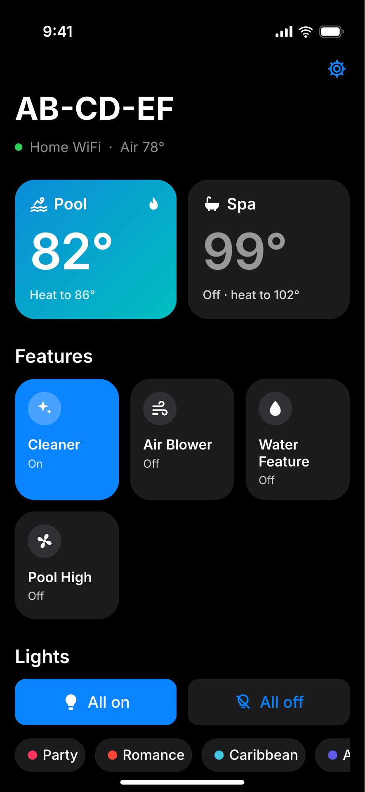
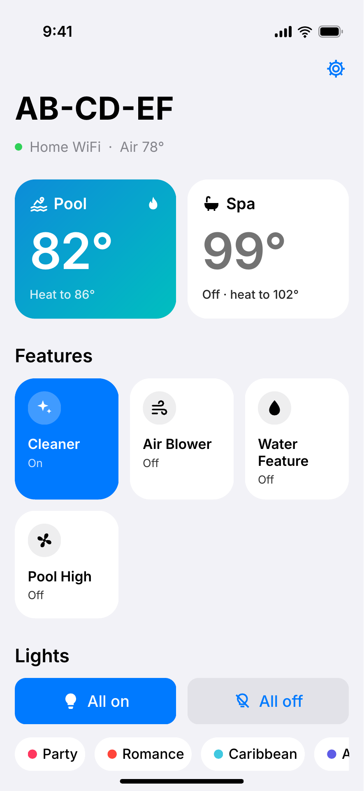
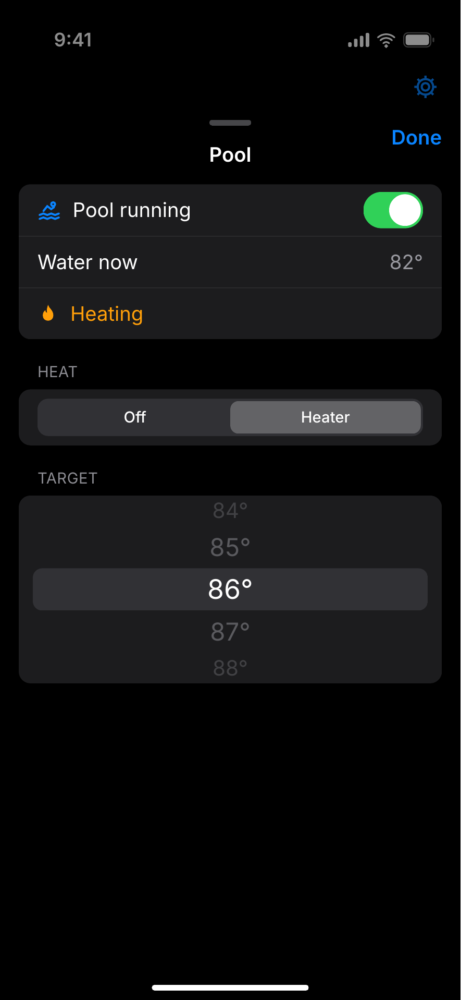
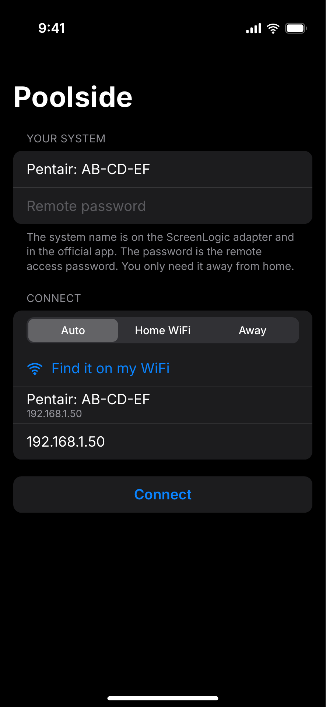

# Poolside

A personal iOS app for a Pentair ScreenLogic pool system. Works on home WiFi and away from home. See SPEC.md for what it does and why.

## Design

These are mockups drawn from the SwiftUI layout, not screenshots from a phone. Real screenshots come once it's built and running.

<p>




</p>

Home shows pool and spa as big tiles with the water temp, then features and lights. Tap a body for the heat sheet: on or off, heat mode and target temp. Sign in takes the system name, and the remote password only matters away from home.

## Run it on your phone

1. Open `Poolside.xcodeproj` in Xcode 16 or newer. (If it won't open, `brew install xcodegen && xcodegen` in this folder rebuilds it from `project.yml`.)
2. Select the Poolside target, then Signing & Capabilities, and pick your team. A personal Apple ID works.
3. If Xcode complains about the bundle id, change `com.stylehatch.poolside` to anything unique.
4. Plug in the iPhone, turn on Developer Mode if asked, and press Run.
5. On first launch, allow Local Network access. Without it the app can only connect remotely.
6. Sign in with the system name (`Pentair: XX-XX-XX`) and the remote access password. "Find it on my WiFi" fills the name in if the adapter answers.

A free Apple ID install expires after 7 days. A paid developer account keeps it for a year.

## Try it without touching the pool

```
python3 tools/mock_gateway.py --port 8080 --password 1234
```

Then in the app: Home WiFi, adapter IP = your Mac's IP, port 8080 in Settings. The mock answers discovery, login, status and every command, and keeps state in memory.

To check your real adapter from a Mac before debugging the app (read-only, changes nothing):

```
python3 tools/protocol_check.py --discover
python3 tools/protocol_check.py --host 192.168.1.50
python3 tools/protocol_check.py --remote "Pentair: 12-34-56" --password 1234
```

The password check needs `pip install cryptography`.

## Layout

- `Poolside/Protocol`: ScreenLogic wire format, login, password encryption, discovery, Pentair's remote lookup.
- `Poolside/Model`: sign-in storage (Keychain for the password) and the app state.
- `Poolside/Views`: dashboard, heat sheet with the temperature wheel, sign-in, settings.
- `tools`: the mock adapter and the read-only checker.

## What's been checked

- The mock adapter and the checker were run against node-screenlogic, the reference library: discovery, password encryption (matches its test vector), config, status and all four commands agree.
- The app builds cleanly in Xcode 26 for the iOS simulator.
- Tried read-only against a real adapter: the checker logged in on home WiFi with no password and read config and status. Over Pentair's remote server, the checker and the app's Swift protocol code both logged in and decoded the same values.
- Discovery found the real adapter on WiFi. Only the subnet broadcast got an answer; the 255.255.255.255 broadcast didn't.
- No commands (circuits, heat, lights) have been sent to real equipment yet.

## Credits

Protocol details come from node-screenlogic (MIT) and screenlogicpy (GPL-3.0). Personal use, not affiliated with Pentair.
